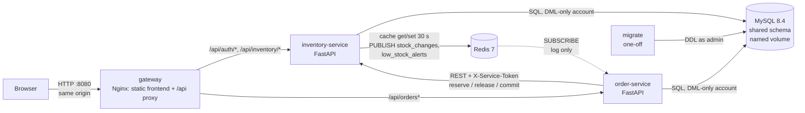
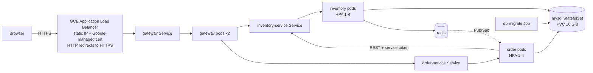

# Architecture

Editable source for the architecture diagrams (Mermaid; renders on GitHub and in most Markdown
viewers). This replaces the earlier `Architecture Design.png`, which showed the order service as a
second "Inventory-Service" and did not show the shared database or the Redis directions.

## Docker Compose (local)



Only the gateway publishes a port. MySQL, Redis and the two services are reachable only on the
Compose network (`docker-compose.debug.yml` maps them to 127.0.0.1 for debugging).

## Kubernetes / GKE



Locally the load balancer is replaced by an ingress controller (ingress-nginx or Traefik) over
plain HTTP. Same images, same gateway config, same environment variable names.

## Data ownership and coupling (honest version)

Both services use **one MySQL schema**. That is a deliberate course-scale trade-off, not a
"pure" microservice database-per-service design:

- inventory-service owns `products`, `inventory`, `stock_reservations`, `stock_reservation_items`.
- order-service owns `orders`, `order_items`.
- Coupling that exists: foreign keys from `order_items` and `stock_reservation_items` to
  `products` (a product with order history cannot be deleted; the API returns 409), and both
  services' tables are created by the same migration (`db/migrate.py`).
- order-service never reads or writes inventory tables directly; all stock changes go through
  the inventory REST API. inventory-service no longer queries `order_items` in code (it relies on
  the FK instead).

## Order and stock consistency

There is no transaction spanning MySQL and an HTTP call, so the flow is a small recoverable saga:

```mermaid
sequenceDiagram
  participant C as Client
  participant O as order-service
  participant DB as MySQL (orders)
  participant I as inventory-service
  C->>O: POST /api/orders (Idempotency-Key)
  O->>I: GET product prices
  O->>DB: insert order PENDING, inventory_sync=RESERVE_PENDING, reservation_id
  O->>I: POST /reservations {reservation_id, merged items}
  Note over I: one DB transaction, row locks,<br/>all-or-nothing, idempotent per id
  alt reserved
    O->>DB: CAS -> CREATED / RESERVED
    O-->>C: 201 (resend with same key -> 200, no second deduction)
  else definite rejection (409/404)
    O->>DB: delete draft order
    O-->>C: 409/404
  else timeout / 5xx (outcome unknown)
    O->>I: POST /reservations/{id}/release (tombstones unknown ids)
    O->>DB: FAILED / RELEASED (or stays RESERVE_PENDING if release also failed)
    O-->>C: 503
  end
  Note over O: reconcile loop (every 30 s, any replica) retries<br/>*_PENDING states; all calls are idempotent
```

Status changes (PATCH status, POST cancel) all go through one state machine:
`CREATED -> PAID -> SHIPPED -> REFUNDED`, `CREATED -> CANCELLED`, `PAID -> REFUNDED`.
Cancel/refund before shipping releases the reservation exactly once; shipping commits it;
refund after shipping returns money only (returned goods are restocked manually).
Only CANCELLED/REFUNDED/FAILED orders without pending stock work can be deleted.

## Redis: cache and event log, not a source of truth

- Product list cache, TTL 30 s, generation key bumped after every write (a slow reader cannot
  put an older list back). Fail-open: Redis down means reads go to MySQL. Stock checks and
  reservations never use the cache.
- Pub/Sub channels `stock_changes` and `low_stock_alerts`. The order-service subscriber
  (`redis.asyncio`, reconnects automatically) only logs the event and keeps the last 20 in memory
  (`GET /api/orders/events/recent`). **Planned, not implemented:** e-mail alerts,
  auto-replenishment, live browser push. Pub/Sub does not store messages: events published while
  no subscriber is connected are lost, which is acceptable only because nothing depends on them.

## Security boundaries

- Users authenticate at `/api/auth/login` (inventory-service) and get an 8-hour HS256 token;
  roles `viewer` (read) and `staff` (read/write). Both services verify the token.
- order-service -> inventory-service uses a separate service token; the gateway strips that
  header from browser requests. Reservation endpoints accept only the service token.
- Same-origin frontend; no CORS unless `CORS_ALLOWED_ORIGINS` is set. CSP without inline
  scripts; all API data is rendered with `textContent`.
- Details and limits: [SECURITY.md](SECURITY.md).
